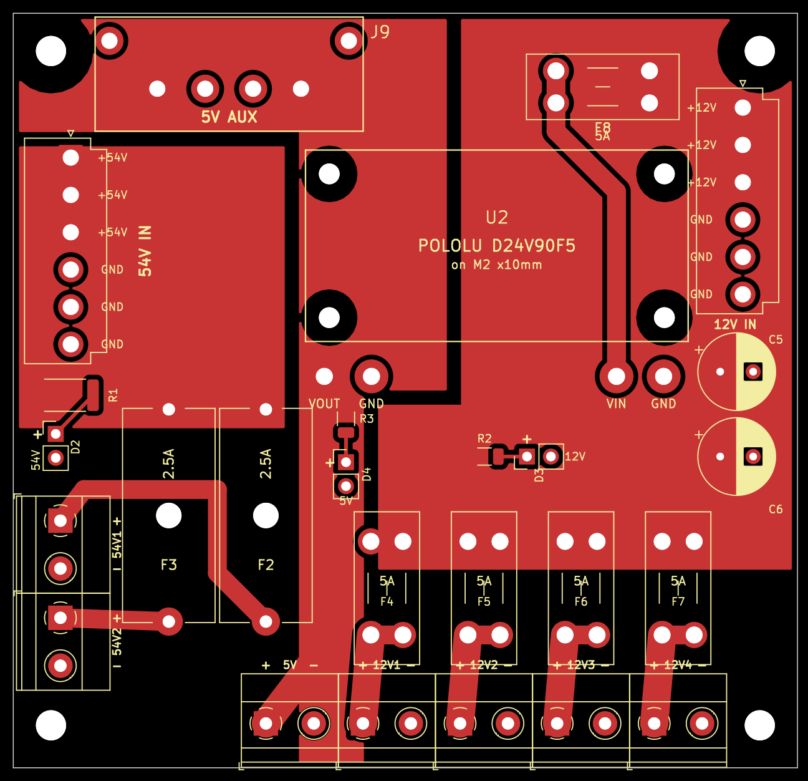
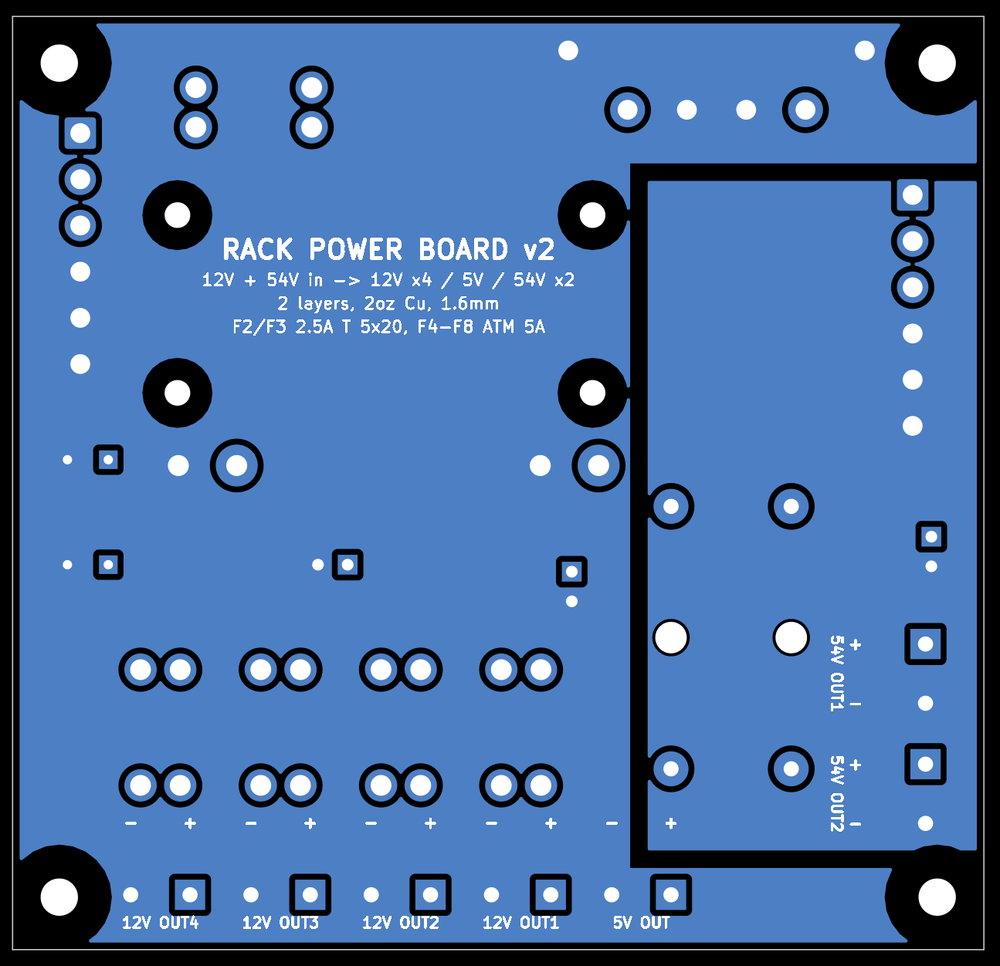

# Rack power board v2: separate 12 V and 54 V supplies

Variant of the [v1 board](../rack-power-board/README.md) for a case with **two** Mean Well
supplies: a LOP-300-54 for 54 V and a **LOP-200-12 or LOP-300-12** for 12 V. There is no
DC-DC brick. The board is 50.8 mm (2") narrower than v1, to leave room for the second PSU.

| Output | Connector | Protection | Rating |
|---|---|---|---|
| 54 V IN | J1 (6-pin JST VH, left edge, top end) | — (LOP-300-54's own protection) | from LOP-300-54 |
| 12 V IN | J10 (6-pin JST VH, right edge, top end) | — | from LOP-200-12 / LOP-300-12 |
| 54 V OUT 1 / 2 | J2, J3 (screw terminals, left edge, bottom end) | F2, F3 5×20 T 2.5 A | 2 A each |
| 5 V OUT | J8 (screw terminal, bottom edge) | F8 ATM 5 A on the Pololu's 12 V feed; Pololu current limit | 6 A, **shared with J9** |
| 12 V OUT 1–4 | J4–J7 (screw terminals, bottom edge) | F4–F7 ATM mini blade (5 A, or 3 A per load) | 3–5 A each |
| 5 V AUX | J9 (4-pin Molex 8981, top edge, far left) | same as J8 | pinout **+5V, GND, GND, +5V** |

* **Board:** 83.2 × 80.0 mm, 2 layers, **2 oz copper**, 1.6 mm. 4× M3 holes, 9 mm Ø
  copper keep-out around each.
* **Outputs** are 2-pin 5.08 mm screw terminals (YE0001XC321 or any 5.08 mm block that fits
  the Phoenix MKDS-1,5 footprint: 1.3 mm holes, body 10.16 × 9.8 mm), with the wire entry
  flush with the board edge. Each output has its own + and GND screw (no shared grounds).
  * **Bottom edge**, left to right: **5V, 12V 1, 12V 2, 12V 3, 12V 4**, side by side at
    10.3 mm pitch. The left screw of each block (marked `+`) is positive.
  * **Left edge**, as low as the corner mounting hole allows: **54V 1** (upper) and **54V 2**
    (lower), wires entering from the left. The upper screw of each block (marked `+`) is
    positive.
  * Screw terminals have no polarity keying: go by the `+`/`−` marks next to each block
    (also printed on the bottom). Use ferrules on stranded wire.
  * With 5 V next to the 54 V block, no supply rail has to cross another one.
* **Inputs:** J1 (54 V) on the left edge and J10 (12 V) on the right edge, both at the top
  end, so each sits next to its own PSU. Both are B6P-VH headers, plugs entering from above. On both,
  pins 1–3 (top, next to the ▽ mark) are **+** and pins 4–6 are **GND**. Three contacts per
  pole give 30 A. Make both cables with a **VHR-6N** housing, SVH-41T-P1.1 contacts and
  1.25 mm² (AWG 16) wire, and use all six wires. Check each LOP's own output connector in
  its datasheet for the other end of the cable. Label the two cables: they use the same
  connector and swapping them would put 54 V on the 12 V side.
* **54 V is a fused passthrough** with its **own ground (GND54)**. The whole left column
  below J9 is the 54 V block: J1 feeds F2/F3 and J2/J3 through a +54 V copper pour on the
  top layer, and the bottom layer there is GND54, with a 1.5 mm gap to the 12 V/5 V ground.
  Nothing on the 12 V/5 V side connects to it, and there is no option to tie the two
  grounds (the two LOP supplies have isolated outputs).
* **5 V:** the same Pololu D24V90F5 as v1, lying horizontally between the two inputs on 4×
  M2 × 10 mm standoffs. Wire it with 1 mm² leads to P3 (VOUT, left) and P4 (GND), and to
  P1 (VIN, right) and P2 (GND). A +5 V copper pour feeds J9 above and J8 below.
* **J9** sits on the top edge as far left as the corner mounting hole allows (pin 1 at
  15.3 mm). The right-angle plug enters from the top edge.
* **J9 warning:** its pinout (+5V, GND, GND, +5V) is **not** the PC standard (+12V, GND,
  GND, +5V). Never plug a PC PSU's peripheral cable into it.
* **Status LEDs** are 2-pin 2.54 mm headers (D2 = 54 V, D3 = 12 V, D4 = 5 V), so the LEDs
  can sit in the case front and connect with female Dupont leads. Pin 1 (marked `+`) is
  the LED anode, already behind its series resistor (R1–R3 stay on the board); pin 2 is
  GND (GND54 for D2). The resistors set about 10 mA for a plain red LED without a built-in resistor (Lumex SSI-LXMP059ID panel-mount LEDs). A header with a Dupont
  housing on it is about 14 mm tall, a mated VH input plug about 17 mm, and the screw
  terminals about 10 mm.

## Mounting holes

Coordinates are in mm from the board's **top-left corner**, as seen from the component
side, with the output connector edge at the bottom. X runs right and Y runs down. All
holes are unplated (NPTH).

| Hole | Purpose | X | Y | Drill | Notes |
|---|---|---|---|---|---|
| H1 | board mount | 4.00 | 4.00 | 3.2 mm (M3) | 9 mm Ø copper-free area on both sides |
| H2 | board mount | 79.20 | 4.00 | 3.2 mm (M3) | same |
| H3 | board mount | 4.00 | 75.50 | 3.2 mm (M3) | same |
| H4 | board mount | 79.20 | 75.50 | 3.2 mm (M3) | same |
| H5 | Pololu standoff | 33.52 | 17.03 | 2.2 mm (M2) | 6 mm Ø copper-free area on both sides |
| H6 | Pololu standoff | 69.08 | 17.03 | 2.2 mm (M2) | same |
| H7 | Pololu standoff | 33.52 | 32.27 | 2.2 mm (M2) | same |
| H8 | Pololu standoff | 69.08 | 32.27 | 2.2 mm (M2) | same |

* **Board outline:** 83.2 × 80.0 mm.
* **M3 pattern:** 75.2 × 71.5 mm centre-to-centre, inset 4 mm from the top, left and
  right edges and 4.5 mm from the output connector edge.
* **M2 pattern (Pololu):** 35.56 × 15.24 mm (the D24V90F5's own holes).

## Layout and copper

* **Top layer:** +54 V pour in the left column (J1 to F2/F3); +5 V pour along the top-left
  (J9), under the left half of the Pololu and down to J8; +12 V pour from J10 to F8, C5/C6,
  D3 and the 12 V fuses.
* **Bottom layer:** GND everywhere except the 54 V block (GND54).
* **Pad connections:** power pads join the pours solidly (no thermal reliefs). Use a hot
  iron (≥ 60 W) for J*, F* and the wire pads.

## Bill of materials

For part numbers, order status and DigiKey Ireland part numbers and prices, see **[BOM.md](BOM.md)**.
Compared with v1, v2 drops U1, C1–C4, C7, C8, D1, F1 (and its fuse) and JP1, uses a 6-pin
header for J1, and adds J10.

## Power budget

* **12 V supply:** J4–J7 at 5 A each (20 A) plus the Pololu at 6 A × 5 V (about 2.8 A at
  12 V) adds up to about 23 A worst case. A LOP-300-12 (25 A) covers that. A LOP-200-12
  (16.7 A) is fine as long as the **actual** combined 12 V + 5 V load stays under 200 W.
* **54 V supply:** the LOP-300-54 now only feeds J2/J3 (2 × 2.5 A fuses), well under its
  5.6 A. Its own overload protection covers the J1 wiring, so there is no input fuse.

## Before ordering: check these

1. **J1/J10 cables:** confirm the output connector on both LOPs and make the cables to
   match. Keep the order (pins 1–3 +, 4–6 −) and mark which cable is 54 V.
2. **Pololu wiring:** check its VIN/GND/VOUT labels and wire it to P1–P4.
3. **J9 footprint:** the right-angle tab holes come from measurements of your own headers.
4. **Screw terminals:** check that your blocks fit the 1.3 mm holes at 5.08 mm pitch and are
   no wider than 10.3 mm, so the five on the bottom edge sit side by side.
5. **Fuse holders and blade holders:** they use the KiCad library footprints (Schurter
   0031.8201, Keystone 3568). Compare them against the parts you actually buy.

## Files

* `rack-power-board-v2.kicad_pcb`: KiCad 7 board (board-only, nets assigned, no schematic).
* `rack-power-board-v2-gerbers.zip`: gerbers and drill files. Upload as-is to JLCPCB/PCBWay
  and pick 2 oz copper.
* `docs/`: top and bottom renders, a top assembly PDF and the DRC report. The report has 0
  electrical violations and 0 unconnected items; the remaining entries are silkscreen
  overlaps and "library not configured" notices from generating the board by script.
* `build.py` / `post.py`: the generator scripts (KiCad 7 `pcbnew` Python). Run
  `python3 build.py && python3 post.py` to regenerate, fill zones and run DRC.
