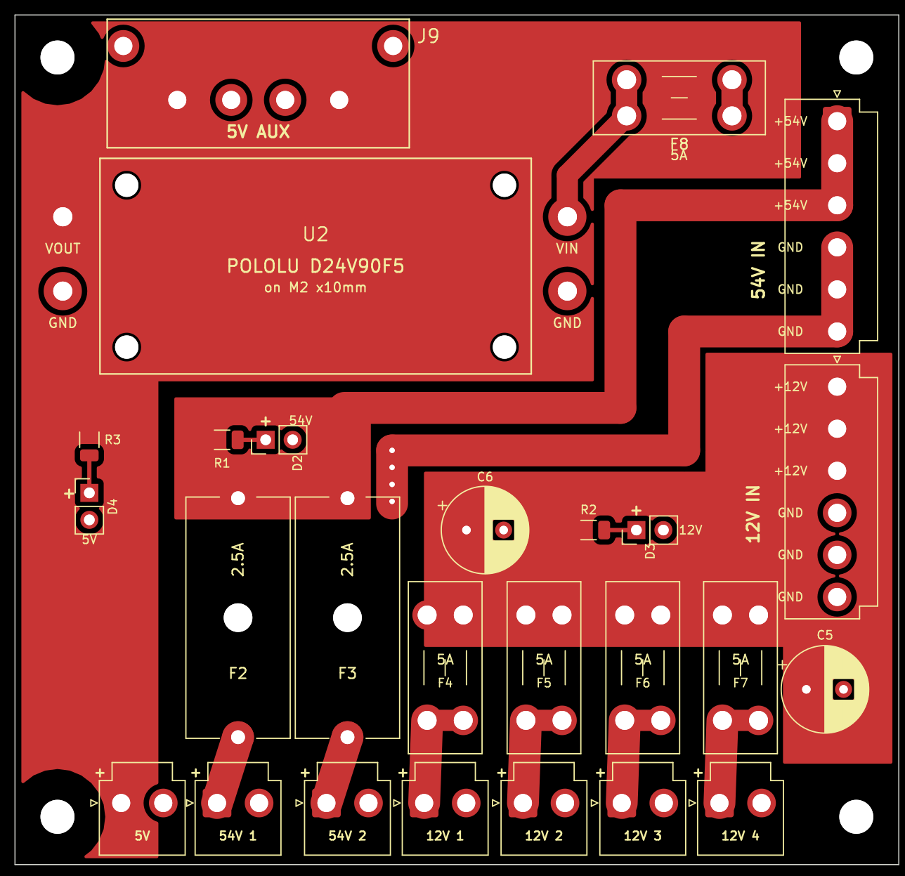

# Rack power board v2: separate 12 V and 54 V supplies

Variant of the [v1 board](../rack-power-board/README.md) for a case with **two** Mean Well
supplies: a LOP-300-54 for 54 V and a **LOP-200-12 or LOP-300-12** for 12 V. There is no
DC-DC brick. The board is 50.8 mm (2") narrower than v1, to leave room for the second PSU.

| Output | Connector | Protection | Rating |
|---|---|---|---|
| 54 V IN | J1 (6-pin JST VH, right edge, top) | — (LOP-300-54's own protection) | from LOP-300-54 |
| 12 V IN | J10 (6-pin JST VH, right edge, below J1) | — | from LOP-200-12 / LOP-300-12 |
| 5 V OUT | J8 | F8 ATM 5 A on the Pololu's 12 V feed; Pololu current limit | 6 A, **shared with J9** |
| 54 V OUT 1 / 2 | J2, J3 | F2, F3 5×20 T 2.5 A | 2 A each |
| 12 V OUT 1–4 | J4–J7 | F4–F7 ATM mini blade (5 A, or 3 A per load) | 3–5 A each |
| 5 V AUX | J9 (4-pin Molex 8981, top edge, far left) | same as J8 | pinout **+5V, GND, GND, +5V** |

* **Board:** 83.2 × 80.0 mm, 2 layers, **2 oz copper**, 1.6 mm. 4× M3 holes, 9 mm Ø
  copper keep-out around each.
* **Output row** (bottom edge, left to right): **5V, 54V 1, 54V 2, 12V 1, 12V 2, 12V 3,
  12V 4**. All are straight JST VH 2-pin headers (B2P-VH), pin 1 (left, marked `+`) positive.
  Putting 5 V on the far left keeps the whole 5 V side (Pololu, J8, J9) in the left half of
  the board, so only the Pololu's small 12 V feed has to cross the 54 V wiring.
* **Inputs (J1, J10):** B6P-VH headers on the right edge, plugs entering from above. On both,
  pins 1–3 (top, next to the ▽ mark) are **+** and pins 4–6 are **GND**. Three contacts per
  pole give 30 A. Make both cables with a **VHR-6N** housing, SVH-41T-P1.1 contacts and
  1.25 mm² (AWG 16) wire, and use all six wires. Check each LOP's own output connector in
  its datasheet for the other end of the cable. Label the two cables: they use the same
  connector and swapping them would put 54 V on the 12 V side.
* **54 V is a fused passthrough** with its **own ground (GND54)**. J1 feeds F2/F3 and J2/J3
  only, over two 3 mm top-layer tracks that run left below the Pololu to the 54 V fuse
  block. That block has its own GND54 copper on the bottom layer, with a 1.5 mm gap to the
  12 V/5 V ground. Nothing on the 12 V/5 V side connects to it. See JP2 below if you want
  the grounds tied.
* **5 V:** the same Pololu D24V90F5 as v1, lying horizontally just below J9 on 4×
  M2 × 10 mm standoffs. Wire it with 1 mm² leads to P1 (VIN, right) and P2 (GND), and to
  P3 (VOUT, left) and P4 (GND). The left half of the top layer is a +5 V copper pour that
  feeds J9 above and J8 down the left edge.
* **J9** sits on the top edge as far left as the corner mounting hole allows (pin 1 at
  15.3 mm). The right-angle plug enters from the top edge.
* **J9 warning:** its pinout (+5V, GND, GND, +5V) is **not** the PC standard (+12V, GND,
  GND, +5V). Never plug a PC PSU's peripheral cable into it.
* **Status LEDs** are 2-pin 2.54 mm headers (D2 = 54 V, D3 = 12 V, D4 = 5 V), so the LEDs
  can sit in the case front and connect with female Dupont leads. Pin 1 (marked `+`) is
  the LED anode, already behind its series resistor (R1–R3 stay on the board); pin 2 is
  GND (GND54 for D2). Use plain LEDs without a built-in resistor. A header with a Dupont
  housing on it is about 14 mm tall; a mated VH plug about 17 mm.

## Mounting holes

Coordinates are in mm from the board's **top-left corner**, as seen from the component
side, with the output connector edge at the bottom. X runs right and Y runs down. All
holes are unplated (NPTH).

| Hole | Purpose | X | Y | Drill | Notes |
|---|---|---|---|---|---|
| H1 | board mount | 4.00 | 4.00 | 3.2 mm (M3) | 9 mm Ø copper-free area on both sides |
| H2 | board mount | 79.20 | 4.00 | 3.2 mm (M3) | same |
| H3 | board mount | 4.00 | 75.50 | 3.2 mm (M3) | same |
| H4 | board mount | 79.20 | 75.50 | 3.2 mm (M3) | same |
| H5 | Pololu standoff | 10.52 | 16.03 | 2.2 mm (M2) | |
| H6 | Pololu standoff | 46.08 | 16.03 | 2.2 mm (M2) | |
| H7 | Pololu standoff | 10.52 | 31.27 | 2.2 mm (M2) | |
| H8 | Pololu standoff | 46.08 | 31.27 | 2.2 mm (M2) | |

* **Board outline:** 83.2 × 80.0 mm.
* **M3 pattern:** 75.2 × 71.5 mm centre-to-centre, inset 4 mm from the top, left and
  right edges and 4.5 mm from the output connector edge.
* **M2 pattern (Pololu):** 35.56 × 15.24 mm (the D24V90F5's own holes).

## Layout and copper

* **Top layer:** +5 V pour on the left and along the top; +12 V pour from J10 to the 12 V
  fuses, C5/C6 and D3; +54 V pour around the F2/F3 tops; the two 54 V tracks between them.
* **Bottom layer:** GND everywhere except the 54 V block (GND54). The 12 V feed for the
  Pololu runs on the bottom layer from J10 pin 1 up to F8, crossing under the 54 V tracks.
* **Pad connections:** power pads join the pours solidly (no thermal reliefs). Use a hot
  iron (≥ 60 W) for J*, F* and the wire pads.

## Jumpers

| Jumper | Default | Meaning |
|---|---|---|
| **JP2** (bottom side, at the edge of the 54 V block) | open | Bridge it with solder to tie **GND54 to GND**. Leave it open to keep the 54 V side fully separate. The two LOP supplies have isolated outputs, so either choice is safe. |

## Bill of materials

For manufacturer part numbers and ordering links (DigiKey Ireland), see **[BOM.md](BOM.md)**.
Compared with v1, v2 drops U1, C1–C4, C7, C8, D1, F1 (and its fuse) and JP1, uses a 6-pin
header for J1, and adds J10 and JP2.

## Power budget

* **12 V supply:** J4–J7 at 5 A each (20 A) plus the Pololu at 6 A × 5 V (about 2.8 A at
  12 V) adds up to about 23 A worst case. A LOP-300-12 (25 A) covers that. A LOP-200-12
  (16.7 A) is fine as long as the **actual** combined 12 V + 5 V load stays under 200 W.
* **54 V supply:** the LOP-300-54 now only feeds J2/J3 (2 × 2.5 A fuses), well under its
  5.6 A. Its own overload protection covers the J1 wiring, so there is no input fuse.

## Before ordering: check these

1. **J1/J10 cables:** confirm the output connector on both LOPs and make the cables to
   match. Keep the order (pins 1–3 +, 4–6 −) and mark which cable is 54 V.
2. **Pololu wiring:** check its VIN/GND/VOUT labels and wire it to P1–P4.
3. **J9 footprint:** the right-angle tab holes come from measurements of your own headers.
4. **Fuse holders and blade holders:** they use the KiCad library footprints (Schurter
   0031.8201, Keystone 3568). Compare them against the parts you actually buy.

## Files

* `rack-power-board-v2.kicad_pcb`: KiCad 7 board (board-only, nets assigned, no schematic).
* `rack-power-board-v2-gerbers.zip`: gerbers and drill files. Upload as-is to JLCPCB/PCBWay
  and pick 2 oz copper.
* `docs/`: top and bottom renders, a top assembly PDF and the DRC report. The report has 0
  electrical violations and 0 unconnected items; the remaining entries are silkscreen
  overlaps and "library not configured" notices from generating the board by script.
* `build.py` / `post.py`: the generator scripts (KiCad 7 `pcbnew` Python). Run
  `python3 build.py && python3 post.py` to regenerate, fill zones and run DRC.
