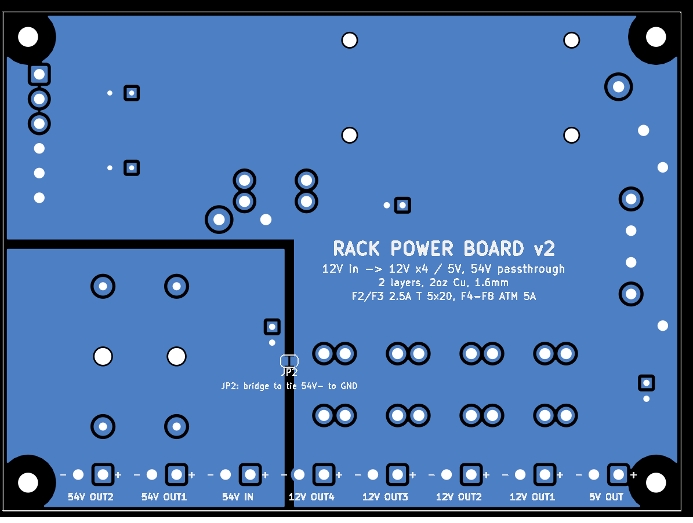

# Rack power board v2: separate 12 V supply

Variant of the [v1 board](../rack-power-board/README.md) for a case with **two** Mean Well
supplies: a LOP-300-54 for 54 V and a **LOP-200-12 or LOP-300-12** for 12 V. There is no
DC-DC brick. The board is 25.4 mm (1") narrower than v1, to leave room for the second PSU.

| Output | Connector | Protection | Rating |
|---|---|---|---|
| 12 V IN | J10 (6-pin JST VH, right edge) | — | from LOP-200-12 / LOP-300-12 |
| 12 V OUT 1–4 | J4–J7 | F4–F7 ATM mini blade (5 A, or 3 A per load) | 3–5 A each |
| 5 V OUT | J8 | F8 ATM 5 A on the Pololu's 12 V feed; Pololu current limit | 6 A, **shared with J9** |
| 5 V AUX | J9 (4-pin Molex 8981, left edge) | same as J8 | pinout **+5V, GND, GND, +5V** |
| 54 V IN | J1 | — (LOP-300-54's own protection) | from LOP-300-54 |
| 54 V OUT 1 / 2 | J2, J3 | F2, F3 5×20 T 2.5 A | 2 A each |

* **Board:** 108.6 × 80.0 mm, 2 layers, **2 oz copper**, 1.6 mm. 4× M3 holes, 9 mm Ø
  copper keep-out around each.
* **54 V is a fused passthrough.** J1 feeds F2/F3 and J2/J3 only. It has its **own ground
  (GND54)** in the bottom-right corner, separated from the 12 V/5 V ground by a 1.5 mm gap.
  Nothing on the 12 V/5 V side connects to it. See JP2 below if you want the grounds tied.
* **12 V input (J10):** a B6P-VH header on the right edge, plug entering from above.
  Pins 1–3 (top, next to the ▽ mark) are **+12 V**, pins 4–6 are **GND**. Three contacts
  per pole give 30 A, enough for the LOP-300-12's 25 A. Make the cable with a **VHR-6N**
  housing, SVH-41T-P1.1 contacts and 1.25 mm² (AWG 16) wire, and use all six wires.
  Check the LOP's own output connector in its datasheet for the other end of the cable.
* **5 V:** the same Pololu D24V90F5 as v1, lying horizontally in the top-left corner on 4×
  M2 × 10 mm standoffs. Wire it with 1 mm² leads to P1 (VIN), P2 (GND), P3 (VOUT) and
  P4 (GND). The 5 V outputs J8 (bottom-left) and J9 (left edge) are both right next to it,
  so the 5 V routes are short (about 6 cm to J8).
* **J9 placement:** J9 now sits on the left edge, near J8, not at the opposite end of the
  board as in v1. On this narrower board the far end is taken by J10 and the 54 V block,
  and keeping J9 next to the Pololu avoids a long 5 V run.
* **J9 warning:** its pinout (+5V, GND, GND, +5V) is **not** the PC standard (+12V, GND,
  GND, +5V). Never plug a PC PSU's peripheral cable into it.
* **Status LEDs** are 2-pin 2.54 mm headers (D2 = 54 V, D3 = 12 V, D4 = 5 V), so the LEDs
  can sit in the case front and connect with female Dupont leads. Pin 1 (marked `+`) is
  the LED anode, already behind its series resistor (R1–R3 stay on the board); pin 2 is
  GND (GND54 for D2). Use plain LEDs without a built-in resistor. A header with a Dupont
  housing on it is about 14 mm tall; a mated VH plug about 17 mm.

## Mounting holes

Coordinates are in mm from the board's **top-left corner**, as seen from the component
side, with the connector edge at the bottom. X runs right and Y runs down. All holes are
unplated (NPTH).

| Hole | Purpose | X | Y | Drill | Notes |
|---|---|---|---|---|---|
| H1 | board mount | 4.00 | 4.00 | 3.2 mm (M3) | 9 mm Ø copper-free area on both sides |
| H2 | board mount | 104.60 | 4.00 | 3.2 mm (M3) | same |
| H3 | board mount | 4.00 | 75.50 | 3.2 mm (M3) | same |
| H4 | board mount | 104.60 | 75.50 | 3.2 mm (M3) | same |
| H5 | Pololu standoff | 17.52 | 4.53 | 2.2 mm (M2) | |
| H6 | Pololu standoff | 53.08 | 4.53 | 2.2 mm (M2) | |
| H7 | Pololu standoff | 17.52 | 19.77 | 2.2 mm (M2) | |
| H8 | Pololu standoff | 53.08 | 19.77 | 2.2 mm (M2) | |

* **Board outline:** 108.6 × 80.0 mm.
* **M3 pattern:** 100.6 × 71.5 mm centre-to-centre, inset 4 mm from the top, left and
  right edges and 4.5 mm from the connector edge.
* **M2 pattern (Pololu):** 35.56 × 15.24 mm (the D24V90F5's own holes, board turned 90°
  compared with v1).

## Layout and copper

* **Top layer:** a +12 V pour from J10 across the top of the board to F4–F8 (the Pololu
  sits above it on standoffs), and a separate +54 V pour feeding F2/F3.
* **Bottom layer:** GND under everything except the 54 V block, which has its own GND54
  pour. The 12 V return current has a wide path back to J10 pins 4–6.
* **5 V:** a top-layer trunk down the left edge from P3 to J8, with short stubs to J9 and R3.
* **Pad connections:** power pads join the pours solidly (no thermal reliefs). Use a hot
  iron (≥ 60 W) for J*, F* and the wire pads.

## Jumpers

| Jumper | Default | Meaning |
|---|---|---|
| **JP2** (bottom side, between the two ground areas) | open | Bridge it with solder to tie **GND54 to GND**. Leave it open to keep the 54 V side fully separate. Bridging is only useful if something needs a common reference between the 54 V and 12 V/5 V loads. The two LOP supplies have isolated outputs, so either choice is safe. |

## Bill of materials

For manufacturer part numbers and ordering links (DigiKey Ireland), see **[BOM.md](BOM.md)**.
Compared with v1, v2 drops U1, C1–C4, C7, C8, D1, F1 (and its fuse) and JP1, and adds J10
and JP2.

## Power budget

* **12 V supply:** J4–J7 at 5 A each (20 A) plus the Pololu at 6 A × 5 V (about 2.8 A at
  12 V) adds up to about 23 A worst case. A LOP-300-12 (25 A) covers that. A LOP-200-12
  (16.7 A) is fine as long as the **actual** combined 12 V + 5 V load stays under 200 W.
* **54 V supply:** the LOP-300-54 now only feeds J2/J3 (2 × 2.5 A fuses), well under its
  5.6 A. Its own overload protection covers the J1 wiring, so there is no input fuse.

## Before ordering: check these

1. **J10 cable:** confirm the output connector on your LOP-x-12 and make the cable to
   match. Keep the +12 V/GND order (pins 1–3 +, 4–6 −).
2. **Pololu wiring:** check its VIN/GND/VOUT labels and wire it to P1–P4.
3. **J9 footprint:** the right-angle tab holes come from measurements of your own headers.
4. **Fuse holders and blade holders:** they use the KiCad library footprints (Schurter
   0031.8201, Keystone 3568). Compare them against the parts you actually buy.

## Files

* `rack-power-board-v2.kicad_pcb`: KiCad 7 board (board-only, nets assigned, no schematic).
* `rack-power-board-v2-gerbers.zip`: gerbers and drill files. Upload as-is to JLCPCB/PCBWay
  and pick 2 oz copper.
* `docs/`: top and bottom renders, a top assembly PDF and the DRC report. The report has 0
  electrical violations and 0 unconnected items; the remaining entries are silkscreen
  overlaps and "library not configured" notices from generating the board by script.
* `build.py` / `post.py`: the generator scripts (KiCad 7 `pcbnew` Python). Run
  `python3 build.py && python3 post.py` to regenerate, fill zones and run DRC.
