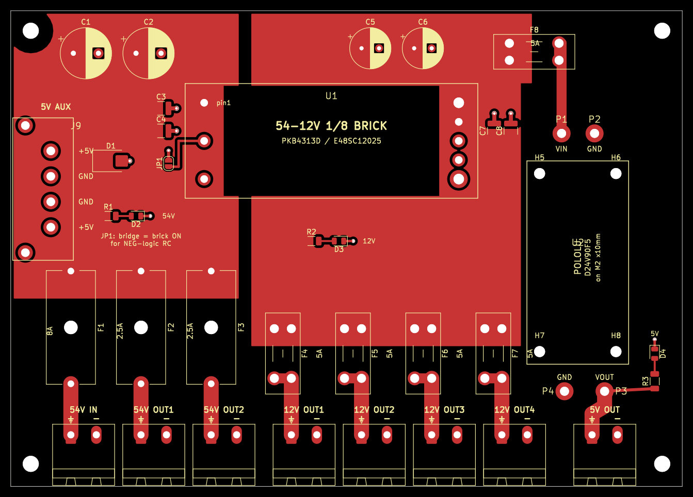
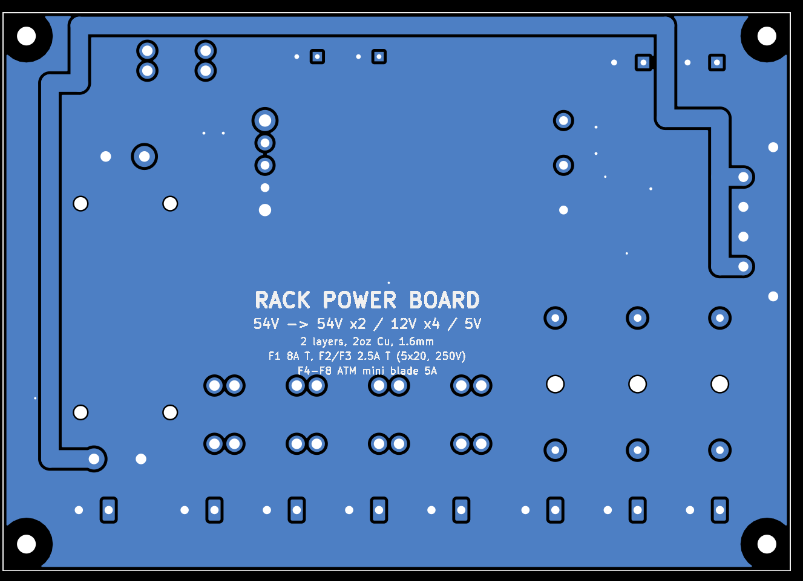

# Rack power board: 54 V → 54 V / 12 V / 5 V

A distribution and conversion board for a 3D-printed 1U 10" rack case. It is fed from a
Mean Well LOP-300-54 and provides:

| Output | Connector | Protection | Rating |
|---|---|---|---|
| 54 V IN | J1 | F1 5×20 T 8 A + SMBJ58A TVS | from LOP-300-54 |
| 54 V OUT 1 / 2 | J2, J3 | F2, F3 5×20 T 2.5 A | 2 A each |
| 12 V OUT 1–4 | J4–J7 | F4–F7 ATM mini blade (5 A, or 3 A per load) | 3–5 A each |
| 5 V OUT | J8 | F8 ATM 5 A on the 12 V feed; Pololu current limit | 6 A, **shared with J9** |
| 5 V AUX | J9 (4-pin Molex 8981, left edge) | same as J8 | pinout **+5V, GND, GND, +5V** |

* **Board:** 134 × 78.5 mm, 2 layers, **2 oz copper**, 1.6 mm. 4× M3 holes 4 mm in from the
  corners, with a 4.5 mm copper keep-out around each. It fits the 140 × 150 × 30 mm space.
* **Connectors:** J1–J8 are straight JST VH 2-pin headers (B2P-VH, 3.96 mm pitch, 10 A per
  contact) along the long board edge. The crimp plugs (VHR-2N) go in from above. Pin 1 (left,
  marked `+`) is positive. A mated VH plug stands roughly 17 mm above the board, so check the
  wire bend room under the lid with your standoff height. J9 is a
  right-angle 4-pin "disk drive" Molex header on the left edge, with its plug entering from
  the left.
* **J9 warning:** its pinout (+5V, GND, GND, +5V) is **not** the PC standard (+12V, GND,
  GND, +5V). Never plug a PC PSU's peripheral cable into it, or that supply's 12 V gets fed
  into the 5 V rail.
* **12 V:** a DOSA eighth-brick isolated converter (36–75 V in, 12 V / 25 A, about 95 %
  efficient). It runs at roughly half load, so the case fans are enough cooling and no
  heatsink is needed.
* **5 V:** a Pololu D24V90F5 (12 V → 5 V, about 9 A) on 4× M2 × 10 mm standoffs above the
  board. It is wired with 1 mm² leads to pads P1 (VIN), P2 (GND), P3 (VOUT) and P4 (GND),
  using its own 5 mm terminal blocks.

## Mounting holes

Coordinates are in mm from the board's **top-left corner**, as seen from the component
side, with the connector edge at the bottom. X runs right and Y runs down. All holes are
unplated (NPTH).

| Hole | Purpose | X | Y | Drill | Notes |
|---|---|---|---|---|---|
| H1 | board mount | 4.00 | 4.00 | 3.2 mm (M3) | 9 mm Ø copper-free area on both sides |
| H2 | board mount | 130.00 | 4.00 | 3.2 mm (M3) | same |
| H3 | board mount | 4.00 | 74.00 | 3.2 mm (M3) | same |
| H4 | board mount | 130.00 | 74.00 | 3.2 mm (M3) | same |
| H5 | Pololu standoff | 105.53 | 22.52 | 2.2 mm (M2) | |
| H6 | Pololu standoff | 120.77 | 22.52 | 2.2 mm (M2) | |
| H7 | Pololu standoff | 105.53 | 58.08 | 2.2 mm (M2) | |
| H8 | Pololu standoff | 120.77 | 58.08 | 2.2 mm (M2) | |

* **Board outline:** 134.0 × 78.5 mm.
* **M3 pattern:** 126.0 × 70.0 mm centre-to-centre, inset 4 mm from the top, left and
  right edges and 4.5 mm from the connector edge. Use printed bosses in the case with M3
  heat-set inserts, at least 5 mm tall, with screw heads or washers up to 9 mm Ø.
* **M2 pattern (Pololu):** 15.24 × 35.56 mm, matching the D24V90F5's own holes. Use 10 mm
  M2 standoffs.

## Layout and copper

* **Top layer:** a +54 V pour on the left and a +12 V pour in the middle. There is no top
  copper under the open-frame brick body.
* **Bottom layer:** one common GND pour. The 54 V return and the 12 V/5 V return are tied
  together, so the brick's input/output isolation is deliberately not used. J9's ground pins
  sit on the 54 V side of the board, which needs a single ground there.
* **5 V to J9:** a 3 mm bottom-layer track from P3, along the right and top edges and down to
  J9 (about 25 cm, roughly 0.15 V drop at 6 A).
* **Fused outputs:** each output runs on a 3 mm track from its fuse to its connector.
* **Pad connections:** power pads join the pours solidly, with no thermal reliefs. Use a
  hot iron (≥ 60 W) for J*, F* and U1.

## Jumpers (set before use)

| Jumper | Default | Meaning |
|---|---|---|
| **JP1** (top, beside U1 pin 2) | open | Bridge it for a **negative-logic** brick (RC pulled to −In = ON, e.g. Delta …N…). Leave it open for a **positive-logic** brick (RC open = ON). Check your part's datasheet. Flex says the standard PKB4000D product is negative logic, and a "P" ordering suffix gives positive logic. |

## Bill of materials

For manufacturer part numbers and ordering links (DigiKey Ireland), see **[BOM.md](BOM.md)**.

| Ref | Qty | Part | Notes |
|---|---|---|---|
| U1 | 1 | Delta **E48SC12025NRFH** (from Mouser), or any DOSA 1/8-brick 36–75 V → 12 V ≥ 200 W, e.g. Flex PKB4313DPI | The Delta is negative logic, so bridge JP1. 5-pin and 8-pin bricks both fit (sense pins are tied locally). See [BOM.md](BOM.md). |
| U2 | 1 | Pololu **D24V90F5** (#2866) + 4× M2 × 10 mm standoffs and screws | about US$37 direct |
| J1–J8 | 8 | JST **B2P-VH** 2-pin header, 3.96 mm, straight | on hand |
| J9 | 1 | 4-pin 5.08 mm "Molex" (8981-style) header, straight **or** right-angle | 1.7 mm pin holes. The footprint also has two plated 1.7 mm tab holes (GND) for the right-angle version: one pitch beyond each end pin, one pitch towards the board edge. They stay empty when a straight header is fitted. |
| (J9 plug) | 1 | 4-pin 8981 / Mate-N-Lok plug + cable | on hand |
| (plugs) | 8 | JST **VHR-2N** housing + SVH crimp contacts | on hand |
| F1–F3 | 3 | Schurter **0031.8201** 5×20 PCB fuse holder (open) | add the 0853.0551 cover if you want touch protection |
| F1 fuse | 1 | 5×20 T **8 A** 250 V (Littelfuse 218 series) | |
| F2, F3 fuse | 2 | 5×20 T **2.5 A** 250 V (Littelfuse 218 series) | |
| F4–F8 | 5 | Keystone **3568** mini-blade (ATM) PCB holder | |
| F4–F8 fuse | 5 | ATM mini blade **5 A** (32 V) | use 3 A for smaller loads |
| C1, C2 | 2 | 68 µF 100 V low-ESR electrolytic, Ø10 mm, 5 mm pitch, **≤ 20 mm tall** | the brick needs ≥ 100 µF on its input |
| C3, C4 | 2 | 2.2 µF 100 V X7R 1210 | |
| C5, C6 | 2 | 470 µF 16 V aluminium polymer, Ø8 mm, 3.5 mm pitch | brick output load 100–10 000 µF |
| C7, C8 | 2 | 22 µF 25 V X5R 1210 | |
| D1 | 1 | **SMBJ58A** TVS (SMB) | |
| D2–D4 | 3 | LED 0805 | 54 V / 12 V / 5 V indicators |
| R1 | 1 | 47 kΩ 1206 | 54 V LED (~1 mA, 60 mW) |
| R2 | 1 | 4.7 kΩ 1206 | 12 V LED |
| R3 | 1 | 1 kΩ 1206 | 5 V LED |
| — | 4 | Printed M3 bosses + M3 heat-set inserts (case), M2 × 10 mm standoffs (Pololu) | on hand |

## Power budget

The LOP-300-54 supplies 300 W (5.6 A). If every output ran at its maximum
(54 V outputs 2 × 2 A = 216 W, plus about 165 W for the 12 V/5 V side), the total would be
about 380 W. That is fine as long as the **actual** combined load stays under 300 W. If it
goes over, the LOP's overload protection trips first, and F1 (8 A) protects the board.

## Before ordering: check these

1. **Brick footprint:** it is built from the DOSA eighth-brick standard. Pins 1–3 are on a
   7.62 mm pitch, pins 4–8 on a 3.81 mm pitch, and the two rows are 50.8 mm apart. Holes are
   1.5 mm (pins 1–3, 5–7) and 2.1 mm (pins 4, 8). Print the board 1:1 and lay your brick on
   it to confirm.
2. **Pololu wiring:** the Pololu has no fixed footprint because its pin positions aren't
   published. Check its VIN/GND/VOUT labels and wire it to P1–P4.
3. **J9 footprint:** the right-angle tab holes come from measurements of your own headers. A straight header with its plug fitted may be too tall for the 30 mm case.
4. **Fuse holders and blade holders:** they use the KiCad library footprints (Schurter
   0031.8201, Keystone 3568). Compare them against the parts you actually buy.

## Files

* `rack-power-board.kicad_pcb`: KiCad 7 board. It is board-only, with nets assigned and no
  schematic.
* `rack-power-board-gerbers.zip`: gerbers and drill files. Upload as-is to JLCPCB/PCBWay and
  pick 2 oz copper.
* `docs/`: top and bottom renders, a top assembly PDF and the DRC report. The report has 0
  electrical violations; the remaining entries are silkscreen overlaps and the
  "library not configured" notices that come from generating the board by script.
* `build.py` / `post.py`: the generator scripts (KiCad 7 `pcbnew` Python). Run
  `python3 build.py && python3 post.py` to regenerate, fill zones and run DRC.
